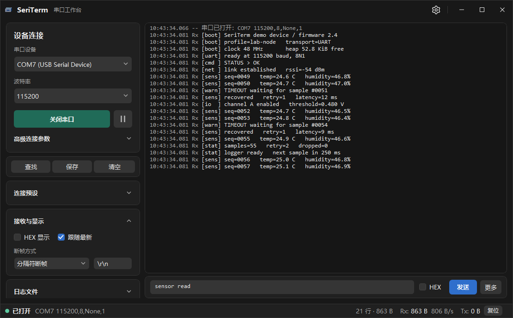

# SeriTerm

[](https://github.com/newMalloc/SeriTerm/actions/workflows/ci.yml)
[](https://github.com/newMalloc/SeriTerm/releases)
[](LICENSE)

[简体中文](README.md) | **English**

An open-source, portable serial tool for Windows. Send text or HEX, search logs, reconnect automatically, and connect AI clients to your serial data through MCP.

## Demo

https://github.com/user-attachments/assets/29c80a35-9e77-477b-be4b-de2314c838ad

[Watch on the web](https://newmalloc.github.io/SeriTerm/video/) · [Download the video](https://github.com/newMalloc/SeriTerm/releases/download/v1.2.3/SeriTerm-1.2.3-intro-1080p.mp4)

## Download

Download from [Releases](https://github.com/newMalloc/SeriTerm/releases). Both files behave the same and are win-x64
single-file builds, no installer required:

| File | Runtime | Use case |
|---|---|---|
| `SeriTerm-<version>-win-x64.exe` | Requires the .NET desktop runtime, installed automatically if missing | General distribution (recommended) |
| `SeriTerm-<version>-win-x64-full.exe` | Bundled in the exe, no network access | Offline / air-gapped machines |

## Features

**Connection**

- Port list shows friendly device names (`COM5 (USB-SERIAL CH340)`)
- Baud rate / data bits / parity / stop bits / flow control; named presets can be saved and reused
- Reopens the last used port at startup; reconnects automatically with exponential backoff

**Receiving**

- Text / HEX modes; UTF-8, GB2312 and other encodings, decoded across chunk boundaries without corruption
- Framing by idle gap / delimiter / none, with a configurable buffer cap; output is per frame, never glued or partial
- Read-only text editor with a configurable buffer capped at 200,000 lines; pause display with `F6` while receiving continues
- Optional timestamps, word wrap and font size; auto-scroll pauses while you scroll up and shows the new line count

**Sending**

- Text / HEX with CR / LF / CRLF line endings
- Timed sending; chunked file sending (cancellable, with progress)
- Terminal mode: send as you type, Enter / Backspace / `Ctrl+C` pass-through, local echo

**Search and copy**

- `Ctrl+F` live search: match counter, next / previous, character-level highlighting
- Bookmarked keywords in an overlay at the log's top-right corner; click to refill the search box and jump to the first match
- Character-level selection within and across lines; `Ctrl+C` copies the selection

**Log to disk**

- Text log and a raw byte log (replayable into the log view), rolled over by size
- Background asynchronous write queue; writing never blocks receiving

**AI access (MCP)**

- Built-in [MCP](https://modelcontextprotocol.io) server; Claude Desktop / Cursor / VS Code can read the device output
  directly — left panel "AI 接入" → "复制配置" to connect
- `serial_wait_for_pattern` blocks until the requested text appears (first line after a reboot, `OK`, `panic`) instead of polling
- Reads return frames already split by your framing settings, with arrival time, direction and a cursor; incremental
  reads neither duplicate nor miss
- Read-only by default: write tools are absent from the tool list. Tick "允许 AI 发送数据（完全权限）" to enable sending;
  the status bar shows the current tier
- Sends are capped at 4096 bytes per call and 3 per second, and leave an `[AI]` audit line in the log
- Local named pipe only, current user only, no network port; see [docs/mcp.md](docs/mcp.md) (Chinese)

**UI**



- Switch between dark and light themes at runtime, with a custom title bar and a choice of solid, frosted glass, or image backgrounds.
- Open About from Settings or press <kbd>F1</kbd> to see the version, commit, runtime, and repository links.

## Requirements

Windows 10 1809 or later (64-bit). The full build needs no runtime; the launcher requires the .NET desktop runtime
(installed automatically if missing). Building from source requires the .NET SDK (see the `TargetFramework` in each
csproj).

## Build and test

```powershell
dotnet build SeriTerm.sln
dotnet run   --project src/SeriTerm.App
dotnet test  SeriTerm.sln
```

Run the automated tests with `dotnet test`.
The loopback group needs a USB-TTL adapter with TX and RX shorted and uses `COM5` by default; the port can be
overridden without touching the source (`$env:SERITERM_LOOPBACK_PORT = 'COM3'`). On a machine without loopback
hardware the group is skipped, not failed.

The MCP path spans three processes (AI client → `--mcp-stdio` bridge → UI process). Unit tests cover the protocol and
its guard rails; before a release, run `pwsh -File tools/mcp-smoke.ps1 -Exe <exe>` for an end-to-end pass.

## Packaging

```powershell
pwsh -File tools/publish.ps1                     # launcher (default, for distribution)
pwsh -File tools/publish.ps1 -All                # launcher + self-contained full build
pwsh -File tools/publish.ps1 -SelfContained      # self-contained full build only
pwsh -File tools/publish.ps1 -FrameworkDependent # framework-dependent single file (local dev)
```

The launcher is a native exe built with
[NativeAOT](https://learn.microsoft.com/dotnet/core/deploying/native-aot/): it carries no .NET runtime, so it starts on
a machine with nothing installed. The application itself (a framework-dependent single file) is Brotli compressed,
embedded inside it and unpacked to `%LocalAppData%\SeriTerm\app\<version>\` on start; older versions are removed
automatically.

Pushing a `v*` tag makes [release.yml](.github/workflows/release.yml) build with `-All` and attach both exes to the
matching Release. The release body is taken from the corresponding section of [CHANGELOG.md](CHANGELOG.md); if that
section is missing, the workflow fails instead of publishing.

## Configuration

- Settings: `%AppData%\SeriTerm\settings.json`
- Diagnostic log: `%AppData%\SeriTerm\ui-errors.log` (written only on failure)

## Known limitations

- **"Port in use" and "device unplugged" are indistinguishable at the Win32 level**: both surface as
  `ERROR_ACCESS_DENIED`. The app reports "in use by another program" only when the port is still enumerated but cannot
  be opened; otherwise it treats the device as unplugged.
- With **frosted glass**, transparency controls how much background color shows through. Blur strength controls how soft background edges appear.
  Windows 10 and Windows 11 21H2 offer clear, light, and strong settings. Windows 11 22H2 and later offer clear and strong. Both sliders preview changes immediately and save when settings close. Reset restores strong blur and 45% transparency. SeriTerm uses a solid background when system transparency is unavailable.
  On systems with three blur levels, Strong uses Windows Composition to blur the live backdrop and reduce the contrast of white and gray areas while preserving the backdrop colors. The blur strength stays constant while you move or resize the window, and log text and controls stay sharp.
- **The search overlay covers a small part of the log's top-right corner**: the trade-off for not spending a log row on
  it. With no search open it collapses and the log uses the full width.
- In a short window the left settings column needs scrolling; "Open port" stays on the first screen.
- **MCP requires the UI process**: SeriTerm must keep running for reads, otherwise tools return `[not_connected]`.
  "复制配置" contains the path of the currently running exe, which changes on upgrade — copy it again.
- The single-file build extracts itself to a temporary directory on first launch, so that launch is slightly slower.

## License

[MIT](LICENSE)

Design decisions, measured numbers and development scripts: [development spec](docs/development-plan.md) and
[verification log](docs/verification.md). AI access (MCP) usage and tool list: [docs/mcp.md](docs/mcp.md). All three
documents are in Chinese.
